# Scenarios

Generated by `SCENARIO_REPORT=1 pnpm exec playwright test e2e/scenarios.spec.js` from
[`tests/scenarios.yaml`](../tests/scenarios.yaml), against the built site. Each trip is
opened the way a shared link opens it, so the numbers are what the app shows (the default
notch). **Waiting for Arnaud's review** before they are frozen as snapshots (spec 10.3).

| # | Trip | Cap | Outcome | Distance | Climb | Steepest | Unconstrained shortest | Checks |
|---|---|---|---|---|---|---|---|---|
| S1 | Filbert & Leavenworth to Filbert & Hyde | 8 % | fallback (needs 12 %) | 2.44 km | 68 m | 11 % | 0.15 km, 23 m, 32 % | pass |
| S2 | 22nd & Church to 22nd & Vicksburg | 8 % | fallback (needs 11 %) | 0.45 km | 25 m | 10 % | 0.10 km, 24 m, 32 % | pass |
| S3 | 22nd & Vicksburg to 22nd & Church (downhill) | 8 % | route, 1 notch | 0.10 km | 0 m | 0 % | 0.10 km, 0 m, 0 % | pass |
| S4 | Ferry Building to Coit Tower | 8 % | fallback (needs 18 %) | 3.19 km | 90 m | 18 % | 2.63 km, 95 m, 18 % | pass |
| S5 | Union Square to the Fairmont (California & Mason) | 8 % | fallback (needs 9 %) | 3.66 km | 93 m | 9 % | 0.88 km, 69 m, 23 % | pass |
| S6 | Civic Center BART to Alamo Square (Hayes & Steiner) | 8 % | fallback (needs 12 %) | 1.91 km | 63 m | 11 % | 1.76 km, 55 m, 12 % | for review: expected a route under the cap |
| S7 | Castro & Market to Church & 20th (top of Dolores Park) | 8 % | route, 1 notch | 1.14 km | 25 m | 7 % | 1.14 km, 30 m, 15 % | pass |
| S8 | Mission & 24th to Castro & 24th | 8 % | route, 3 notches | 2.46 km | 41 m | 6 % | 1.39 km, 39 m, 14 % | pass |
| S9 | Embarcadero & Market to Marina Green (Marina Blvd & Scott) | 5 % | route, 2 notches | 7.69 km | 51 m | 5 % | 4.98 km, 53 m, 14 % | for review: only 29% along |
| S10 | Loop of 3 km from the Ferry Building | 5 % | loop | 2.58 km | 4 m | 2 % |  | pass |
| S11 | Loop of 5 km from Church & 18th (Dolores Park) | 8 % | loop | 4.32 km | 25 m | 3 % |  | pass |
| S12 | Folsom & 20th to Mission & 5th (Arnaud) | 8 % | route, 3 notches | 3.40 km | 8 m | 2 % | 3.18 km, 13 m, 4 % | pass |

## S1: Filbert & Leavenworth to Filbert & Hyde

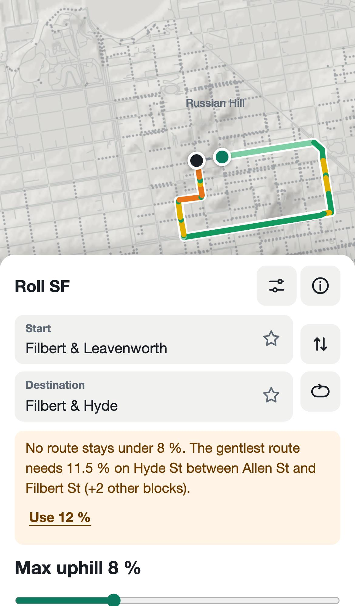

Banner: “No route stays under 8 %. The gentlest route needs 11.5 % on Hyde St between Allen St and Filbert St (+2 other blocks).”

Via: Filbert St → Columbus Avenue → Powell St → Broadway → Larkin St → Green St → Hyde St

- Filbert Street: Leavenworth Street / Hyde Street: not climbed
- Hayes Street: Fillmore Street / Steiner Street: not climbed
- Link: `/#r~8~-~-122.41761~37.80035~-122.41926~37.80014~Filbert_20_26_20Leavenworth~Filbert_20_26_20Hyde`

## S2: 22nd & Church to 22nd & Vicksburg

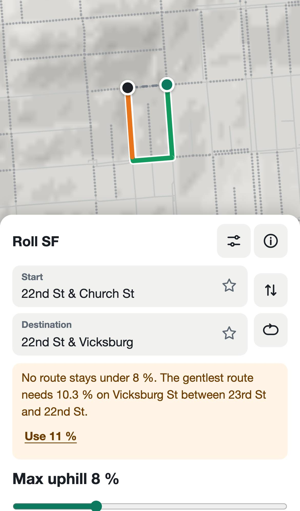

Banner: “No route stays under 8 %. The gentlest route needs 10.3 % on Vicksburg St between 23rd St and 22nd St.”

Via: Church St → 23rd St → Vicksburg St

- 22nd Street: Church Street / Vicksburg Street: not climbed
- Hayes Street: Fillmore Street / Steiner Street: not climbed
- Link: `/#r~8~-~-122.42776~37.75490~-122.42885~37.75483~22nd_20St_20_26_20Church_20St~22nd_20St_20_26_20Vicksburg`

## S3: 22nd & Vicksburg to 22nd & Church (downhill)

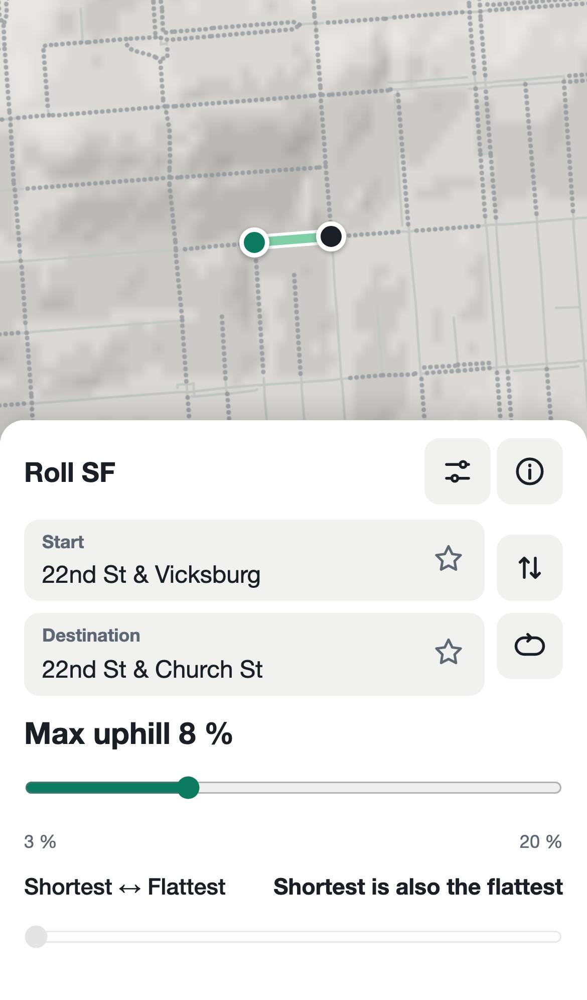

Via: 22nd St

- Hayes Street: Fillmore Street / Steiner Street: not climbed
- Link: `/#r~8~-~-122.42885~37.75483~-122.42776~37.75490~22nd_20St_20_26_20Vicksburg~22nd_20St_20_26_20Church_20St`

## S4: Ferry Building to Coit Tower

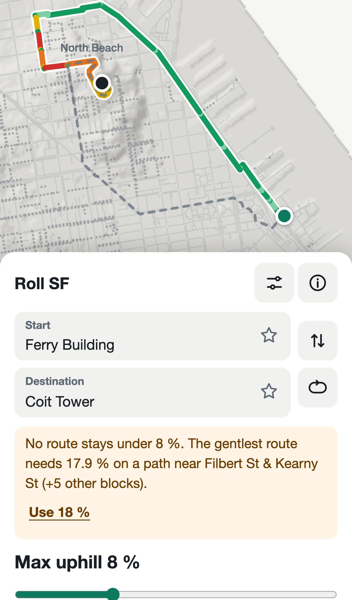

Banner: “No route stays under 8 %. The gentlest route needs 17.9 % on a path near Filbert St & Kearny St (+5 other blocks).”

Via: Herb Caen Way... → The Embarcadero → Bay St → (path) → Bay St → Stockton St → Lombard St → Telegraph Hill Boulevard

- Hayes Street: Fillmore Street / Steiner Street: not climbed
- Link: `/#r~8~-~-122.39347~37.79555~-122.40580~37.80240~Ferry_20Building~Coit_20Tower`

## S5: Union Square to the Fairmont (California & Mason)

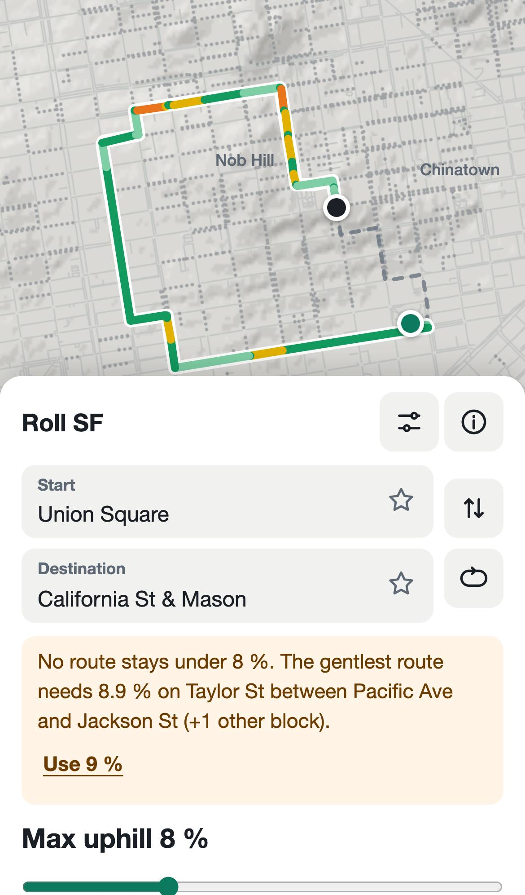

Banner: “No route stays under 8 %. The gentlest route needs 8.9 % on Taylor St between Pacific Ave and Jackson St (+1 other block).”

Via: (path) → Geary St → Larkin St → Sutter St → Polk St → Jackson St → Larkin St → Pacific Avenue → Taylor St → Sacramento St → Mason St

- Hayes Street: Fillmore Street / Steiner Street: not climbed
- Link: `/#r~8~-~-122.40752~37.78794~-122.41083~37.79184~Union_20Square~California_20St_20_26_20Mason`

## S6: Civic Center BART to Alamo Square (Hayes & Steiner)

> **For review:** The spec expects a route under 8%, but Hayes & Steiner is the top corner of Alamo Square: every way up needs at least 12% (the gentlest climbs Fell St), and Hayes is never climbed. Keep this corner (and accept the fallback), or pick a lower corner of the square?

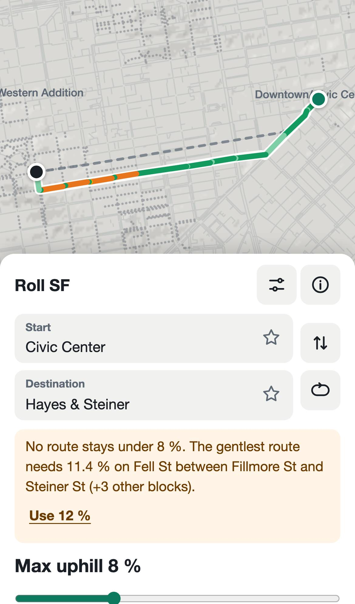

Banner: “No route stays under 8 %. The gentlest route needs 11.4 % on Fell St between Fillmore St and Steiner St (+3 other blocks).”

Via: (path) → Market St → Fell St → Steiner St

- Hayes Street: Fillmore Street / Steiner Street: not climbed
- Link: `/#r~8~-~-122.41396~37.77936~-122.43286~37.77563~Civic_20Center~Hayes_20_26_20Steiner`

## S7: Castro & Market to Church & 20th (top of Dolores Park)

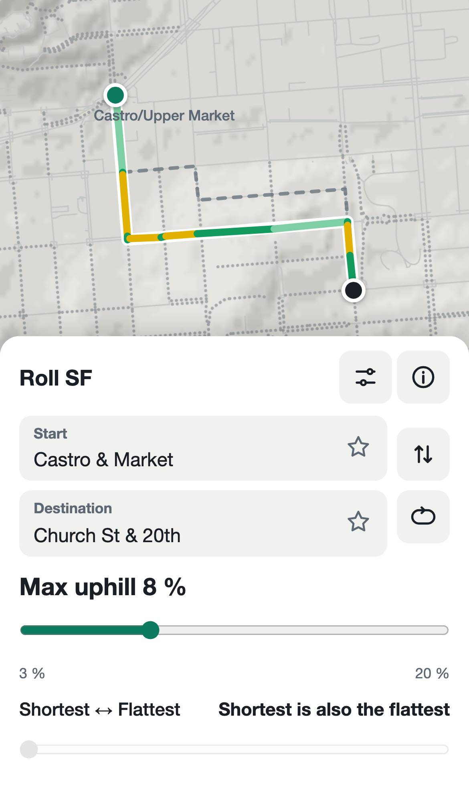

Via: Castro St → 19th St → Church St

- Hayes Street: Fillmore Street / Steiner Street: not climbed
- Link: `/#r~8~-~-122.43520~37.76271~-122.42807~37.75809~Castro_20_26_20Market~Church_20St_20_26_2020th`

## S8: Mission & 24th to Castro & 24th

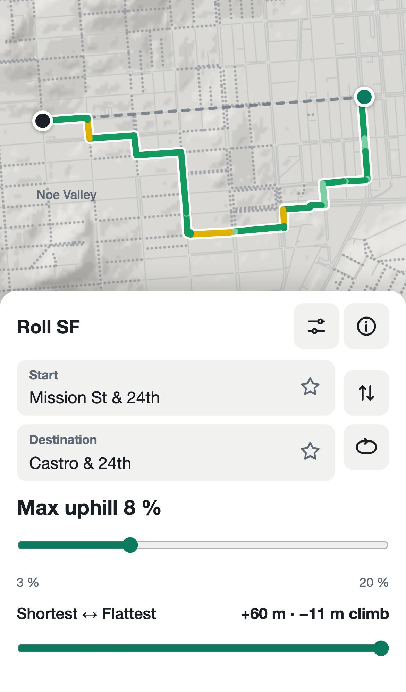

Via: Mission St → 26th St → Valencia St → Cesar Chavez St → (path) → 27th St → Church St → 25th St → Sanchez St → Jersey St → Noe St → 24th St

- Hayes Street: Fillmore Street / Steiner Street: not climbed
- Link: `/#r~8~-~-122.41834~37.75225~-122.43411~37.75130~Mission_20St_20_26_2024th~Castro_20_26_2024th`

## S9: Embarcadero & Market to Marina Green (Marina Blvd & Scott)

> **For review:** At 5% the waterfront is cut at Fort Mason (McDowell Rd 15.8%, Van Ness north of Bay 8.6%); the smallest cap from Aquatic Park to the Marina is 4.8%, by way of North Beach and the Broadway tunnel. Keep 5% and accept the inland route, or raise this trip's cap?

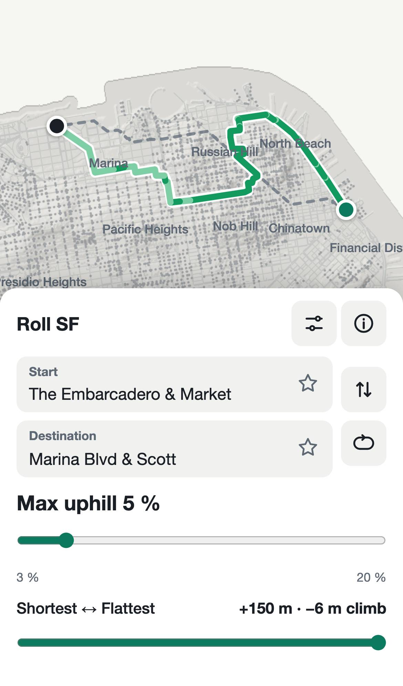

Via: The Embarcadero → North Point St → Powell St → Vandewater St → Mason St → Lombard St → Powell St → Greenwich St → Columbus Avenue → Card Alley → Vallejo St → Powell St → Broadway → Van Ness Avenue → Van Ness Avenue → Filbert St → Franklin St → Greenwich St → Octavia St → Lombard St → Fillmore St → Cervantes Boulevard

- Hayes Street: Fillmore Street / Steiner Street: not climbed
- Link: `/#r~5~-~-122.39426~37.79492~-122.44223~37.80581~The_20Embarcadero_20_26_20Market~Marina_20Blvd_20_26_20Scott`

## S10: Loop of 3 km from the Ferry Building

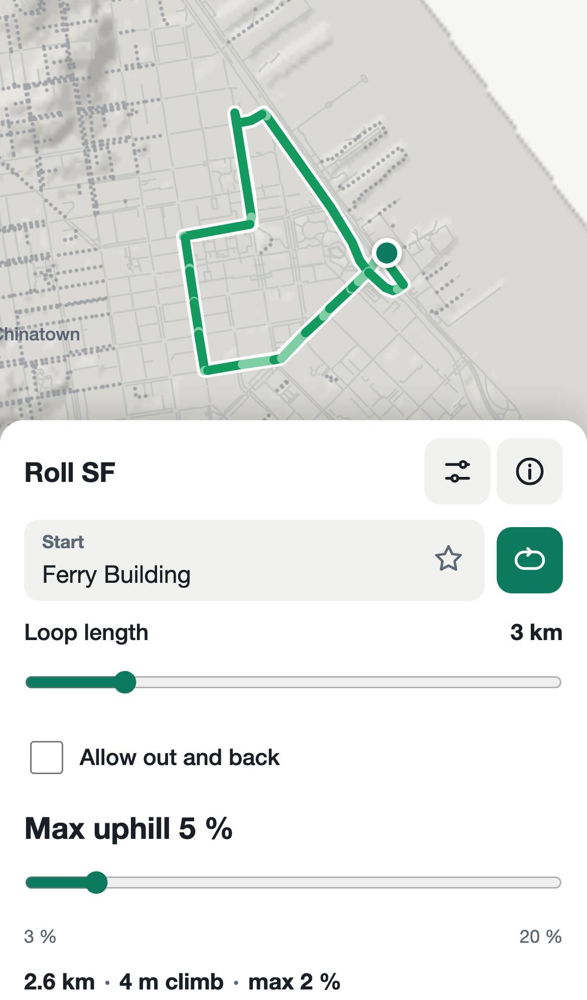

Via: The Embarcadero → Broadway → Davis St → Davis Court → Washington St → Battery St → Pine St → Market St → Steuart St → Market St → The Embarcadero → (path) → Herb Caen Way...

- Link: `/#l~5~3~-~0~-122.39347~37.79555~Ferry_20Building`

## S11: Loop of 5 km from Church & 18th (Dolores Park)

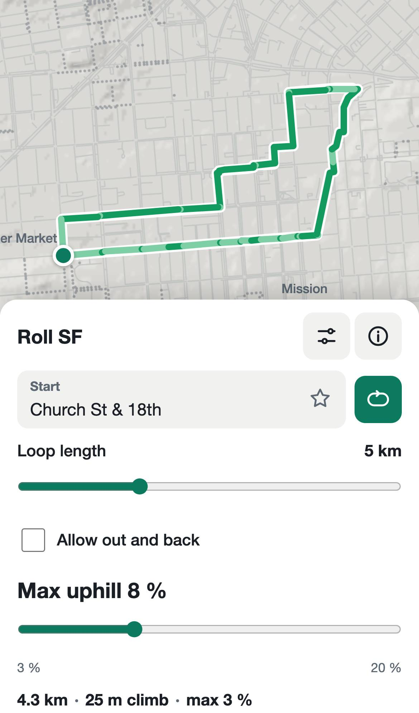

Via: 18th St → Treat Avenue → Harrison St → Treat Avenue → Alabama St → Treat Avenue → (path) → 14th St → Folsom St → (path) → Shotwell St → (path) → 16th St → Mission St → 17th St → Church St

- Link: `/#l~8~5~-~0~-122.42839~37.76128~Church_20St_20_26_2018th`

## S12: Folsom & 20th to Mission & 5th (Arnaud)

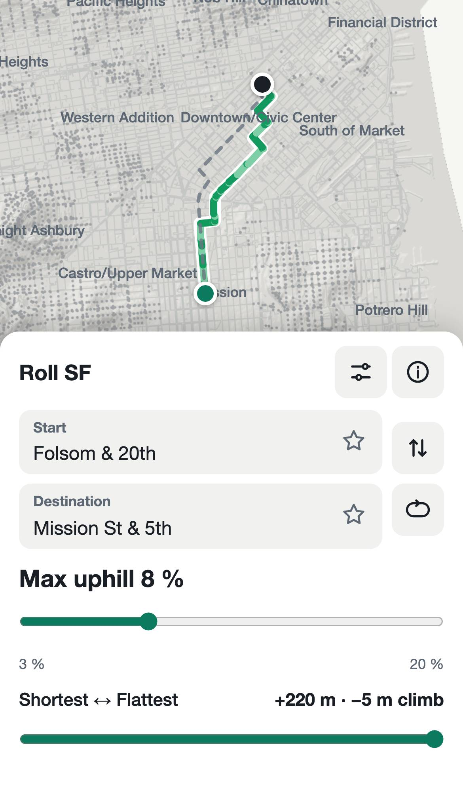

Via: Folsom St → 15th St → Harrison St → 7th St → (path) → Folsom St → 6th St → Howard St → (path) → 5th St

- Hayes Street: Fillmore Street / Steiner Street: not climbed
- Link: `/#r~8~-~-122.41472~37.75891~-122.40649~37.78274~Folsom_20_26_2020th~Mission_20St_20_26_205th`

